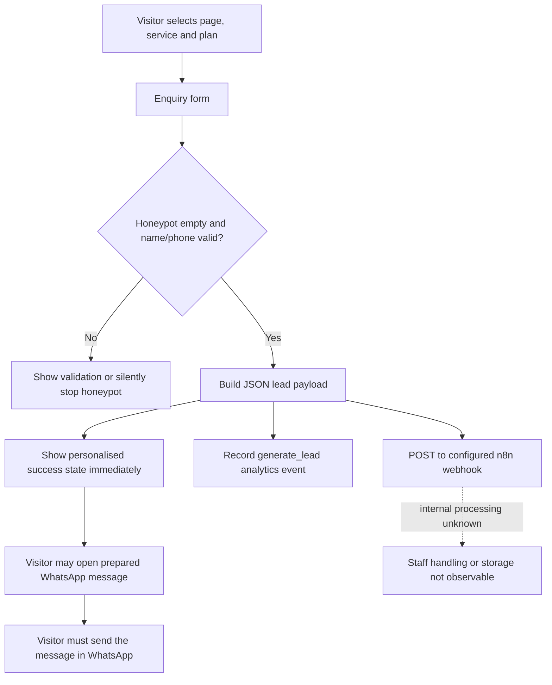

# Probay website research

Research date: 29 October 2026, Asia/Kolkata. Website: https://probay.in/

## Scope and confidence

This is an outside-in study of the public website, its downloadable HTML/CSS/JavaScript, navigation, service content, pricing, policies, and representative live interactions. All 45 sitemap pages were fetched successfully. The alternative homepage `/index.html` was also inspected: 46 HTML URLs representing 45 distinct pages. Robots and sitemap were fetched separately. Ten referenced first-party script, stylesheet and image URLs returned HTTP 200.

The crawl captured 28 form instances and 226 FAQ instances including the duplicate homepage; the distinct-page totals are 27 forms and 218 FAQs. All page content and source evidence were retained locally to support further questions. The accompanying `PAGE-BY-PAGE.md`, `page-inventory.csv`, `inventory.json` and `audit.json` preserve the detailed inventory.

Evidence labels used below:

- **Observed:** present in public content, source or a live browser interaction.
- **Advertised:** a business promise or service description published by Probay, not independently demonstrated.
- **Inferred:** a likely operational implication of the published process.
- **Unknown:** requires internal access, a real engagement, or separate verification.

No valid enquiry was submitted, no WhatsApp message was sent, and no payment or engagement was made. Backend receipt, database storage, delivery to staff and actual professional service execution therefore remain unverified. Robots excludes `/tools/`; that directory was not explored. This research records the site's regulatory statements as claims; it is not an independent legal validation of those statements.

## 1. Business identity and positioning

Probay presents itself as a CA/CS-led professional services business supporting incorporation, recurring ROC compliance, corporate changes, securities dematerialisation and closure. It concentrates its local expertise on Delhi, Noida and Ghaziabad while advertising online service across India. The brand uses the tagline “Supporting You.”

| Published detail | Value |
|---|---|
| Displayed entity | PROBAY™ Limited; structured data says PROBAY LIMITED |
| CIN | U70200UP2026PLC241984 |
| GSTIN | 09AAQCP6154M1ZL |
| Primary telephone and WhatsApp | +91 84474 52345 |
| Secondary telephone | +91 72918 12345 |
| Email | hello@probay.in |
| Registered office | FF12, SPS Residency, Plot No. 18B, Vaibhav Khand, Ghaziabad 201014, Uttar Pradesh |
| Hours | Monday–Saturday, 9:30 AM–6:00 PM |
| Consultation | First 15-minute call advertised as free, without obligation |
| Response expectation | Usually within an hour during business hours; email within one business day |
| Meetings | By appointment; local meetings advertised throughout Delhi NCR |

These identifiers and credentials are website disclosures, not registry checks. No named professional biographies, membership numbers, independent customer reviews or customer case studies were found in the inspected page set. The trust approach relies primarily on professional-role claims, itemised prices, local knowledge, and detailed explanatory content.

The commercial message is low entry pricing plus ongoing accountability: written charges before payment, a dedicated manager, online document handling, deadline reminders, and assistance after incorporation. The About page excludes litigation opinions and acting as statutory auditor for entities whose accounts/filings the team prepares. Independent audit is coordinated separately.

Sources: [home](https://probay.in/), [about](https://probay.in/about.html), [contact](https://probay.in/contact.html).

## 2. Complete information architecture

| Page family | Distinct pages | Purpose |
|---|---:|---|
| Homepage | 1 | Introduce scope, prices, steps, local coverage, FAQs and enquiry |
| Core service pages | 10 | Explain a service and capture qualified enquiries |
| City hubs | 3 | Broad company registration intent for Noida, Ghaziabad and Delhi |
| Service × city pages | 12 | Four services across three cities |
| Guide directory | 1 | Organise 12 educational articles |
| Guides | 12 | Answer selection, incorporation, operation and closure questions |
| Cost calculator | 1 | Create an indicative estimate and WhatsApp quote request |
| About and Contact | 2 | Establish positioning and start a conversation |
| Legal policies | 3 | Privacy, engagement terms and refunds |
| **Total** | **45** | Plus an alternate `/index.html` homepage URL |

There is no standalone pricing page: the navigation points to the homepage pricing section. There is no public account login, customer dashboard, search interface, shopping cart, document-upload portal, booking scheduler or checkout in the discovered page set.

The global header groups services into incorporation, annual compliance and corporate actions; locations into three city hubs; resources into guides, calculator, calendar, entity comparison and About. Contact is direct. The footer repeats registration, compliance, resources, contacts, legal information and six social/directory links.

The 12 service-city pages cover Private Limited incorporation, LLP incorporation, OPC incorporation and Company Annual Filing, each in Noida, Ghaziabad and Delhi. Other services are linked from city hubs to their general pages; no equivalent city-specific public/partnership/ISIN/strike-off page was discovered.

## 3. Shared components and visual system

Observed CSS and page markup establish a shared, responsive component system:

| Component | Content and behavior |
|---|---|
| Skip link | Keyboard route to main content |
| Top strip | Service geography, hours, email and telephone; reduced content on smaller screens |
| Sticky header | Logo, dropdown navigation, phone and consultation CTA; shadow appears after scrolling |
| Desktop menus | Three-column service mega menu; smaller location/resource dropdowns; hover and focus-within |
| Mobile navigation | Toggle icon changes to close; full white panel; one dropdown group opens at a time; body scrolling locked |
| Hero | Navy background, large heading, highlighted text, short pitch, price, checks and primary/WhatsApp CTAs |
| Lead card | White enquiry card with labels, validation, privacy note and alternative success state |
| Fact strip | Four compact service facts such as minimum participants, jurisdiction, deadline or turnaround |
| Table of contents | In-page anchors with active-section tracking; hidden at narrower widths |
| Benefits | Icon cards with short explanations |
| Document boxes | Separate participant and office/company checklists |
| Timeline | Numbered process stages with indicative day/week badges |
| Pricing | Three plan cards in most service families; middle plan visually featured |
| Comparison tables | Entity, geography, closure-route and deadline comparisons; horizontal overflow wrapper |
| Local coverage | Area chips and local explanatory sections |
| Related service cards | Cross-links to relevant next-stage services |
| FAQ | Native details/summary accordion; one open within its parent group |
| Guide cards | Category badge, title, synopsis and reading link |
| Author block | Editorial team attribution and general-information limitation |
| Final CTA band | Consultation/quote and phone link; some anchors are defective, documented below |
| Floating WhatsApp | Page-context message; separate from form-generated message |
| Mobile fixed action bar | Call and quote at widths up to 640px |
| Footer | Dark background, reversed logo, directory columns, contact/address, identifiers and policies |

Design tokens: ink `#081730`, navy `#0b2447`, logo blue `#285997`, amber `#f59e0b`, WhatsApp/action green `#16a34a`, pale surfaces `#f5f8ff` and `#e9f0f9`. Headings use Plus Jakarta Sans; body uses Inter with system fallbacks, loaded through Google Fonts. The maximum content container is 1200px; common corner radii are 8, 14 and 22px. Header height is 72px, reduced to 64px on phones.

Responsive breakpoints include 1100, 980, 760 and 640px. At 980px navigation collapses and many grids become two columns; at 640px most become one column, the featured plan is placed first, illustrations can hide, and the bottom action bar appears. Calculator and article layouts also have later CSS overrides. These are source-confirmed responsive rules; no complete multi-device visual certification was performed.

Accessibility provisions include visible keyboard focus, associated form labels, invalid-state attributes, a status-role toast, decorative SVG hiding, reduced-motion rules, and native disclosure widgets. Areas needing a dedicated accessibility audit include dropdown expanded-state synchronisation, focus management in the mobile panel, announcement of calculator changes, and recovery when JavaScript fails. The mobile menu was visually confirmed open; its contents were not fully exposed by the browser accessibility snapshot, so keyboard/screen-reader usability should be checked separately.

Referenced visual assets: two PNG logos and five SVG illustrations for incorporation, compliance, corporate actions, city coverage and guides. Icons are inserted as inline SVG by the shared script, using a small built-in icon dictionary. No general UI framework or JavaScript dependency is referenced by the inspected first-party behavior files.

Source: [shared stylesheet](https://probay.in/assets/css/style.css?v=2).

## 4. Homepage content and conversion sequence

The homepage moves from a registration pitch and enquiry card to trust cues, a ten-service catalogue, a four-stage process, Private Limited plans, entity comparison, city coverage, differentiation, a compliance calendar, eight FAQs, guide/tool links and a closing consultation CTA.

Its headline price is a professional fee rather than an all-in price. The content repeatedly separates professional work from government charges, stamp duty and DSC. The four-stage overview is consultation, documents/signatures, name approval/filing, then certificate and bank assistance. Cross-links invite visitors who are uncertain to read the structure guide or ask an expert.

The comparison includes Private Limited, LLP, OPC and traditional partnership. The calendar highlights LLP annual return, deposits reporting, AGM, LLP solvency/accounts, financial statements and annual return. The local cards connect founders to relevant city content. The page ends by moving education back into a conversation.

Source: [homepage](https://probay.in/).

## 5. Service catalogue and advertised prices

Amounts below are professional fees as displayed. GST, government charges, stamp duty, signatures and agency charges are excluded unless explicitly included. Annual and event services have different billing periods; these are not interchangeable incorporation bundles.

| Service | Entry / Basic | Standard / main bundle | Premium / alternative |
|---|---:|---:|---:|
| Private Limited incorporation | ₹999 | ₹3,999 | ₹9,999 |
| LLP incorporation | ₹1,499 | ₹4,499 | ₹9,999 |
| OPC incorporation | ₹999 | ₹3,499 | ₹8,999 |
| Public Limited incorporation | ₹9,999 | ₹17,999 | ₹29,999 |
| Partnership setup | ₹1,999 | ₹4,999 | ₹7,999 |
| Company annual filing | ₹4,999 | ₹9,999 | ₹19,999 |
| LLP annual filing | ₹2,999 | ₹5,999 | ₹11,999 |
| ISIN and demat | ISIN Only ₹14,999 | ISIN + Demat ₹24,999 | Annual Care ₹9,999/year |
| Company strike off | ₹4,999 | ₹9,999 | With Backlog from ₹14,999 |
| Event-based compliance | From ₹1,499/event | Individual event schedule | Bundled custom quote |

### Incorporation plan distinctions

- Private Limited Basic covers name, two DINs, constitutional drafting, incorporation and certificates/tax identifiers. Standard adds two DSCs, bank assistance, INC-20A and share records. Premium adds GST, Udyam, auditor appointment and one-year support. Homepage includes some extra descriptions absent from the abbreviated service card; obtain the written scope.
- LLP Basic covers name, two designated-partner identifiers, FiLLiP and incorporation documents. Standard adds two DSCs, agreement, Form 3 and bank support. Premium adds GST, Udyam, first-year Forms 11/8 and support. This matters because the entry price is not the complete agreement-and-compliance package.
- OPC follows the company model with one included DSC at Standard/Premium, nominee documentation and lower upper-tier prices.
- Public Limited Standard includes three directors' DSCs, bank assistance, commencement filing, auditor appointment and registers. Premium adds one-depository ISIN application, RTA support, GST and annual support; additional subscriber signatures may still cost extra.
- Partnership Basic is a deed with two revisions, execution guidance and PAN. Standard adds Registrar of Firms registration, TAN and bank support. Premium adds GST, Udyam and support.

Sources: the five [registration](https://probay.in/private-limited-company-registration.html) service pages, individually indexed in `PAGE-BY-PAGE.md`.

### Recurring and corporate-action scope

Company annual Basic assumes an independent audit is already complete. Standard adds ADT-1, DPT-3, two directors' KYC, board minutes and register maintenance. Premium adds up to 300 bookkeeping entries, financial statements and ITR-6. Posted rates apply to turnover up to ₹1 crore; audit costs remain separate.

LLP annual Basic is for nil/low activity and includes Forms 11/8 and a statement of account. Standard adds financial statements, ITR-5, two designated partners' KYC and reminders. Premium adds up to 300 bookkeeping entries, GST-return support and CA support. The same turnover qualification and separate audit billing are disclosed.

ISIN Only is for one depository; the larger package includes both NSDL/CDSL, up to five shareholders' demat support and first PAS-6. Annual Care is ongoing compliance rather than incorporation. Depository joining/custody and RTA fees are additional.

Strike-off Basic assumes ready accounts/current filings. Standard adds CA-certified accounts, closure guidance and follow-up; backlog work begins at ₹14,999 with late fees extra. STK-2 government fee is advertised separately as ₹10,000. Notary costs can also apply.

Sources: [company filings](https://probay.in/company-annual-filing.html), [LLP filings](https://probay.in/llp-annual-filing.html), [ISIN](https://probay.in/isin-registration-shares-dematerialization.html), [closure](https://probay.in/company-strike-off.html).

### Event-based fee schedule

| Event | Professional fee |
|---|---:|
| Auditor appointment | ₹1,499 |
| Director appointment/resignation | ₹1,999 |
| Registered office change within city | ₹1,999 |
| Share transfer | ₹2,499 |
| Authorised capital increase | ₹2,499 |
| Share allotment | ₹2,999 |
| LLP partner/agreement change | ₹2,999 |
| Charge creation/satisfaction | ₹3,999 |
| Objects / memorandum alteration | ₹4,999 |
| Company name change | ₹5,999 |
| Office relocation across states | From ₹24,999 |

Source: [event-based compliance](https://probay.in/event-based-compliances.html).

## 6. Advertised operational workflows

### Common client lifecycle

Discovery through search, a guide or a local service page → enquiry/call/WhatsApp → needs assessment → written itemised scope and quote → client accepts and pays the quoted advance → client sends documents → team verifies and drafts → client approves/signs → professional certification and portal filing → queries/resubmission if needed → approval and deliverables → bank/setup assistance → recurring reminders and further compliance.

The website describes human service delivery around government portals. It does not show a customer-facing workflow engine. Automated reminders, dedicated-manager assignment and end-to-end case tracking are advertised outcomes; their internal implementation is unknown.

### Workflow matrix

| Service | Published sequence | Indicative turnaround / trigger |
|---|---|---|
| Pvt Ltd | DSC → name reservation → MoA/AoA/consents → SPICe+ and linked forms → certificate/PAN/TAN → account and INC-20A | Usually 7–10 working days |
| OPC | Similar company process with nominee KYC and INC-3 | Usually 7–10 working days |
| LLP | DSC → RUN-LLP → FiLLiP → certificate/LLPIN → stamped agreement and Form 3 → account | Usually 10–15 working days; agreement within 30 days |
| Public company | More participant signatures → company filing → certificate → account, commencement, audit and demat setup | Usually 10–15 working days |
| Partnership | Commercial terms → deed drafting → stamp/execution/notary → PAN/TAN → state firm registration → account/GST | Deed 2–3 working days; registration 2–4 weeks |
| Company annual | MCA history check → financial records → independent audit → meetings/reports → AOC-4 and annual return → challans/reminders | Driven by financial year and AGM |
| LLP annual | History check → partner return → books/accounts/audit if applicable → Form 8 → ITR → receipts | Forms 11/8 advertised for 30 May/30 October |
| Event-based | Identify changes → resolutions and documents → certify/sign → file/pay → approval and registers | Many routine filings 2–5 working days; cross-state moves 2–4 months |
| ISIN/demat | Applicability → board approval → RTA → tripartite agreement → ISIN → shareholder DP accounts → DRFs/physical certificates → credit → PAS-6 | ISIN 2–4 weeks; physical conversion stage around weeks 4–6 |
| Strike off | Eligibility/history → settle liabilities and close bank → pending filings → resolutions/affidavits/accounts → STK-2 → objections → dissolution | Usually 3–6 months overall |

Government or agency processing and client document readiness qualify the advertised times. Service pages contain more granular day/week stages, recorded in the page dossiers.

### Documents and information used by the business

The enquiry stage requests only a name, telephone, city and service, with optional hidden plan selection. Delivery-stage checklists expand to director/partner/shareholder PAN, Aadhaar, other ID, recent address evidence, photograph, email/mobile, office utility bill, owner NOC, tenancy or ownership proof, business objects, proposed names and capital/shareholding details. OPC adds nominee consent. Foreign participants require attestation documents as described by the site.

Annual services need bank statements, transactions, financial statements, earlier forms, loans, changes in ownership/directors, meeting dates, auditor details and DSCs. LLP tax work additionally mentions income-tax login details. Demat needs resolutions, shareholder/certificate records, CA net-worth evidence, DP account details and original share certificates. Closure needs nil-balance accounts, bank closure evidence, affidavits, indemnities and approvals.

The website directs document sharing to WhatsApp/email; no file inputs or upload UI were found. The privacy policy advises waiting until engagement and recipient identity have been confirmed before sending sensitive records.

## 7. Actual enquiry data flow

Source: [main.js](https://probay.in/assets/js/main.js?v=2). This is source-confirmed frontend behavior, not proof of successful server processing.

Payload keys are `name`, `phone`, `city`, `service`, `plan`, and `page`. `page` is the last pathname segment, defaulting to `index.html`. No email, long message, company CIN, uploaded document, UTM, referrer or unique lead identifier is included in this explicit JSON payload.

Configured destination: `https://n8n.srv1323284.hstgr.cloud/webhook/probay-lead`. This endpoint is exposed in the public frontend. It was read, not invoked. The code comments refer to an n8n workflow file under `/tools/`; its actual workflow was not accessed.

Validation trims names and requires at least two characters. Phone validation strips non-digits, accepts an optional 91 or 0 prefix when followed by ten digits, then requires ten digits beginning 6–9. Field editing clears the displayed error; failure focuses the first invalid input. The hidden `website` field is a honeypot: a nonempty value stops submission. Native form validation is disabled in favour of the JavaScript handler.

On a valid form, `fetch` starts a JSON POST, but the code neither awaits it nor inspects HTTP status. Network errors are swallowed. It records a conversion and switches to the success card immediately. Thus “success” means the frontend accepted the input, not that a lead was stored. There is no visible retry, duplicate prevention, request identifier or acknowledgement handling in the inspected script. Server-side validation, throttling, duplicate handling and authentication are unknown.

The success state inserts the visitor's first name and builds a WhatsApp URL containing their full name, number, chosen service, plan and city. That URL opens a prepared conversation; sending the WhatsApp message is a separate user action. The mobile number therefore travels in the JSON request and in the prepared WhatsApp URL if the visitor follows it.

Service-specific forms use a hidden service value. Homepage, Contact and city hubs offer a service dropdown. Generic pages default to Noida and Private Limited where those are the first options. City pages explicitly preselect their own city. Choosing a plan writes the clicked plan to a hidden field on that page and records `select_plan`.

## 8. Calculator logic and exact observable behavior

Sources: [calculator page](https://probay.in/cost-calculator.html), [calculator.js](https://probay.in/assets/js/calculator.js?v=2).

It is a browser-side estimator with fixed configuration, not a live MCA quotation API. Inputs: Pvt Ltd/OPC/LLP, UP/Delhi, capital/contribution, directors/partners and Basic/Standard/Premium. Default is Pvt Ltd, UP, ₹1 lakh, two directors, Standard.

Company capital choices: ₹1, 5, 10 and 15 lakh, then a manual-quote option. LLP choices: ₹1, 5, 10 and 25 lakh. Pvt Ltd and LLP allow 2–5 people; OPC allows 1–3 directors. Switching entity rebuilds capital choices and resets capital to ₹1 lakh, while clamping the previous participant count into the new range. An OPC therefore initially retains two directors if switched from the default Pvt Ltd; it does not automatically become one director.

| Component | Implemented calculation |
|---|---|
| DSC | ₹1,200 per participant; subtract the count included in plan; floor extras at zero |
| PAN/TAN | ₹131 |
| Company name reservation | ₹1,000 |
| Company incorporation fee ≤₹15 lakh | ₹0 |
| Delhi company stamp | MoA ₹200 + rounded 0.15% of capital for AoA + ₹10 |
| UP company stamp | MoA ₹500 + AoA ₹500 through ₹5 lakh, otherwise ₹1,000 + ₹10 |
| LLP name | ₹200 |
| LLP FiLLiP | ₹500 / ₹2,000 / ₹4,000 / ₹5,000 across contribution bands ≤₹1L / ≤₹5L / ≤₹10L / above |
| LLP Form 3 | ₹50 / ₹100 / ₹150 / ₹200 across the same bands |
| LLP agreement stamp, Delhi | 1% contribution, capped at ₹5,000 |
| LLP agreement stamp, UP | 1% contribution |
| GST | Rounded 18% of professional fee only |
| Final total | Government/third-party rows + professional fee + rounded GST |

Included DSC counts are zero for Basic; two for Standard/Premium Pvt Ltd and LLP; one for Standard/Premium OPC. Plan fees match the respective published service pricing. Extra people add extra DSC costs; separate DIN or subscriber complexity is not dynamically priced.

Observed browser checks:

| Scenario | Result |
|---|---:|
| Pvt Ltd, UP, ₹1 lakh, 2 directors, Standard | ₹6,860 |
| Pvt Ltd, Delhi, ₹1 lakh, 2 directors, Standard | ₹6,210 |
| LLP, Delhi, ₹1 lakh, 2 partners, Standard | ₹7,190 |
| OPC after switching from LLP, Delhi, ₹1 lakh, retained 2 directors, Standard | ₹6,820 |
| Company capital above ₹15 lakh | Numeric breakdown removed; manual-quote prompt |

The normal WhatsApp message includes entity, state, capital, people, plan and estimate. The high-capital fallback message includes only generic company/high-capital/state context, losing OPC-vs-Pvt, plan and director count. No calculator values are persisted in local storage by these scripts, and no estimate history/download feature was found.

One first-change `calculator_use` analytics event is recorded per page load. Its parameters reflect the first changed entity/state rather than the full final quote.

## 9. Analytics and third-party dependencies

`main.js` configures GA4 measurement ID `G-M6TPF28DMF`, and dynamically loads Google's tag script only when `location.hostname` is exactly `probay.in`. Clarity has an empty project ID, so its optional code is inactive in this configuration. Other hosts log tracked events to the console.

| Event | Trigger and explicit parameters |
|---|---|
| `form_start` | First focus within a form; hero/content location |
| `select_plan` | Plan button; plan identifier |
| `generate_lead` | Valid client-side submission; service, city, plan |
| `whatsapp_click` | Matching wa.me link; link zone |
| `phone_click` | tel link; link zone |
| `email_click` | mailto link; link zone |
| `calculator_use` | First calculator input change; entity, state |

Every tracked event also receives `page_file`. Link zones distinguish calculator, floating button, mobile bar, topbar, header, success card, lead card, hero, final CTA, footer and generic content. The explicit lead analytics event omits name/phone. Actual GA delivery, dashboard configuration, consent settings and custom conversion configuration were not verified.

External integrations visible publicly: Google Fonts, Google Analytics, WhatsApp, telephone/email handlers, Google business/map share link, and links to YouTube, Instagram, Facebook, LinkedIn and X. Structured business data additionally lists a Linktree URL. Those external profiles were recorded as destinations, not audited as independent websites.

## 10. Local content and SEO strategy

The architecture targets three related intent layers: broad service keywords, city-wide incorporation keywords, and service-specific city keywords. Guides answer pre-purchase questions and cross-link into service conversion pages. Timely calendar content supports ongoing compliance enquiries; closure and disqualification content captures neglected-entity demand.

Noida content emphasises IT/SaaS, exporters, co-working offices, Greater Noida and Gautam Buddha Nagar; Ghaziabad content emphasises manufacturing, trading, family enterprises, industrial property and conversions; Delhi content emphasises consultancies, central institutions, a New Delhi address, mixed property types and capital-linked stamp duty. All identify the local ROC/state distinctions claimed by the firm.

The distinct city pages go beyond name substitutions: utilities, ownership documents, industries, example areas and FAQs vary. Annual filing pages add foreign-investment reporting for Noida/Delhi and secured-loan/MSME issues for Ghaziabad. They reuse the same service pricing and process structure.

Observed search metadata includes canonical links, descriptions, robots instructions, social sharing metadata and JSON-LD. The homepage's `ProfessionalService` schema includes legal identity, contacts, hours, address, service catalogue, geography and external identities. Shared JavaScript generates FAQ structured data from rendered questions/answers. Article/other schema details are preserved in `audit.json` rather than assumed identical across pages.

The XML sitemap lists 45 pages, with 19 October 2026 modification dates. The inspected guides display editorial updates dated 22 September 2026. Privacy is dated 17 October; terms/refund are dated 19 October. These are declared dates, not evidence of editorial review quality or actual publication history.

Robots allows general crawling and names several AI crawlers, but excludes `/tools/` for the generic agent. The site is served through Hostinger/hcdn according to response headers. HTML caching is advertised for one hour. Observed headers include nosniff, SAMEORIGIN, strict-origin-when-cross-origin referrer policy, upgrade-insecure-requests CSP and disabled camera/microphone/geolocation. These observations are not a penetration test or complete security assessment.

## 11. Educational content map

Twelve guides cover the whole commercial lifecycle:

| Topic | Practical content and role |
|---|---|
| Entity comparison | Ownership, liability, investment, audit, tax, costs, six decision questions and common selection mistakes |
| Incorporation cost | Five price components, Delhi/UP table, LLP/OPC differences, recurring costs and cost-control advice |
| Document checklist | Indian/foreign participants, premises evidence, prepared forms and seven common resubmission causes |
| Incorporation process | Integrated registrations, stages/timing, name restrictions, forms and signing roles |
| Registered office | Permitted premises, home/co-working pitfalls, post handling, local rules and relocation routes |
| Delhi vs UP | Jurisdiction, duties, local registrations, premises cost, incentives and cross-state move cost |
| First 180 days | Banking, subscription funds, first meetings/auditor, share records, INC-20A and stationery |
| Annual checklist | Meetings, accounts, audit, ROC, tax, registers, director disclosures and default consequences |
| 2026 calendar | Company/LLP due dates, event triggers, monthly/quarterly tax and payroll rhythm |
| Director disqualification | Default triggers, five-year effect, prevention, court/restoration/amnesty routes and KYC distinction |
| Rule 9B | Applicability, previous deadline, RTA/depository process, demat, PAS-6 and cost ranges |
| Closure options | Strike off, dormant status and liquidation; eligibility, documents, timelines, ongoing personal liability and LLP closure |

The articles use a common editorial layout with a reading time, update date, contents sidebar, related links, author attribution and consultation CTA. Their claims about fees, thresholds, tax and deadlines must be treated as dated site content; current official law was outside this website study.

## 12. Policies, payment and commercial process

Payment is advertised as bank transfer or UPI against an invoice. Work starts after the quote's advance is received. A written quote defines the engagement scope; balances follow invoice terms. No payment integration was found in the public pages or scripts; the refund policy's reference to gateway errors does not demonstrate an active website checkout.

The privacy policy identifies enquiry information, engagement documents and automatic technical data. It states purpose limitation, no sale of personal data, necessary agency/provider sharing, up to 24 months' enquiry retention, longer professional/statutory client retention, access-controlled storage and responses to rights requests within 30 days. These are policy commitments; enforcement was not observable.

Terms require accurate documents, draft approvals, signatures and timely replies. Processing and approval outcomes are qualified. A Probay-caused rejection is to be refiled without additional professional fee. Liability is limited, as far as law permits, to the professional fee paid; indirect loss and client-caused delay penalties are excluded. Indian law and New Delhi courts are specified.

Refunds are generally unavailable after confirmation and commencement. The policy names duplicate payments and excess payments caused by technical/gateway errors as potential exceptions, at company discretion. Requests must arrive within three days; approved refunds are stated to take 7–10 business days to the original method unless otherwise agreed.

Sources: [privacy](https://probay.in/privacy-policy.html), [terms](https://probay.in/terms.html), [refunds](https://probay.in/refund-policy.html), [payment FAQ](https://probay.in/contact.html).

## 13. Concrete issues and ambiguities

| Finding | Evidence and implication | Suggested correction |
|---|---|---|
| Missing consultation anchors | 27 links across 18 distinct pages target their own absent `#lead-form`; includes the calculator's lower quote CTA, About, guide directory, policies and article headers | Route to Contact or homepage form, or provide a real local target |
| Success without server confirmation | POST is unawaited and response status unchecked; UI and lead analytics happen regardless | Confirm receipt before claiming submission; show retry/fallback and lead ID |
| Potential duplicate leads | No disabled submit state or frontend idempotency token; form plus WhatsApp are separate paths | Introduce a lead identifier and server-side duplicate handling |
| Stamp-duty narrative conflicts | Several city pages imply UP is cheaper at small capital; published calculator gives Delhi ₹360 stamp vs UP ₹1,010 at ₹1 lakh; geography guide acknowledges Delhi is lower there | Use capital-dependent wording consistently |
| Fixed-price promise versus terms | Marketing promises the final invoice never exceeds the quote; terms permit changed statutory/third-party charges with notice | Explain quote validity, approval for changes and scope boundaries consistently |
| Package-scope mismatch | Post-incorporation guide says Standard/Premium include its listed steps, while service plans reserve auditor/GST/Udyam to Premium or do not enumerate every task | Publish a precise entitlement matrix |
| LLP calculator labels | Generic Standard dropdown mentions bank/INC-20A although LLP is a different workflow; LLP Basic estimate includes agreement stamp/Form 3 while professional Basic excludes agreement/Form 3 work | Update labels and distinguish cash estimate from purchased deliverables |
| OPC estimate default may surprise | Entity switching retains two directors, increasing price above a one-director OPC | Explain retained inputs or reset to entity minimum |
| High-capital quote loses detail | Fallback WhatsApp text drops entity subtype, count and plan | Preserve all selected inputs |
| Inconsistent OPC exceptions | Generic annual content says all companies hold AGMs, while OPC-specific content correctly advertises no AGM; general checklist lacks the single-director meeting exception found on OPC page | Carry exceptions into shared checklists |
| Calendar arithmetic requires review | Published ADT-1 date 14 October for 30 September AGM differs from its own 15-day wording under ordinary exclusive counting; AOC-4 29 October differs from 30-day addition | Have a professional verify date arithmetic, inclusivity and any circulars; do not rely on this audit for legal dates |
| Other broad regulatory language | Small-company limits, mandatory GST for e-commerce and director/filing statements recur without direct official citations | Review with current official material and add citations/exceptions |
| JavaScript dependency in conversion | Forms use `novalidate`, have no explicit action, and rely on JS for submit interception; calculator starts blank without JS | Add a working fallback; review accidental GET behavior on JS failure |
| Limited attribution payload | Explicit webhook JSON omits campaign/referrer attribution and unique submission ID | Add consent-appropriate attribution and receipt tracing |
| Marketing confidentiality shorthand | Homepage says documents are never shared while privacy correctly permits necessary agencies/providers | Explain authorised sharing in plain language near document collection |

The fragment issue list is exhaustive for the captured internal HTML link graph and is saved in `audit.json`. It is separate from page-level HTTP status: a page can return 200 while an in-page CTA has no destination element. No first-party referenced script/style/image failure was found in the ten checked asset URLs.

## 14. Verification record and remaining unknowns

Completed: sitemap traversal; recursive discovery of same-host HTML links; all 45 distinct public pages read from retrieved HTML; alternative homepage checked; headings, forms, tables, FAQs, links, image references, scripts and metadata captured; public behavior and calculator source inspected; referenced first-party assets checked; internal fragments checked; live calculator paths, mobile-menu appearance, empty-form errors and FAQ accordion observed.

Not demonstrated: successful real enquiry receipt; n8n downstream nodes; storage schema/database; CRM, Sheets, email or WhatsApp automation behind the webhook; actual message delivery; analytics ingestion; staff identity/qualifications; real client delivery; independent statutory accuracy; performance scores; all browser/device combinations; security of private systems; undocumented or unlinked pages; external social-account content.

The visible stack suggests a static multipage website with lightweight client-side behavior and an external lead automation endpoint. The precise backend, deployment pipeline and operating process cannot be reconstructed from that evidence alone.

## Research files

- `PAGE-BY-PAGE.md`: each distinct page's purpose, observed section structure, forms, FAQs and sources.
- `page-inventory.csv`: URL/status/title/description/canonical/headings/form/FAQ counts.
- `inventory.json`: structured crawl evidence, content, links, forms, images, scripts and response headers.
- `audit.json`: fragment defects, asset checks, form fields, component counts and schema snapshots.
- `source/`: local research evidence from the public responses; cached copies are not a licence to republish website content.
- `crawl.py` and `audit.py`: scripts used to collect and check the public evidence.
